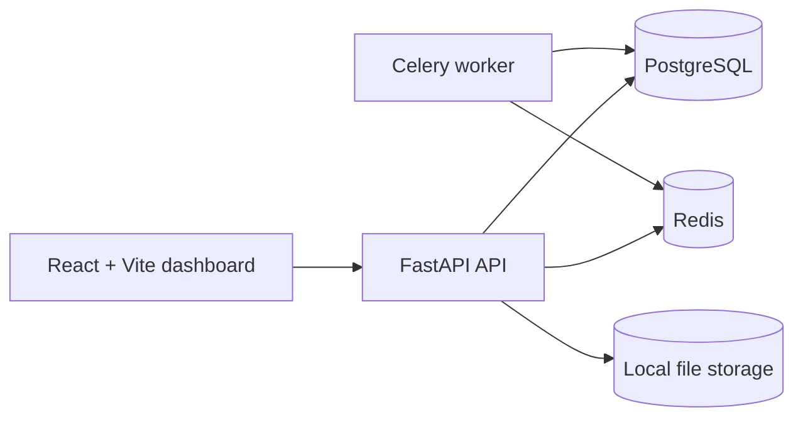

# DataMind

DataMind is an autonomous data quality and investigation platform. The project combines deterministic Python validation tools with a two-agent investigation loop and a polished dashboard.

## Phase 1 status

This repository currently includes the scaffold for:

- FastAPI backend with health endpoint and dataset upload/versioning
- React + Vite frontend shell
- PostgreSQL + pgvector + Redis + Celery service stack
- Alembic migration setup
- Demo dataset generator
- Initial pytest coverage

## Quick start

```bash
cp .env.example .env
python -m venv .venv
source .venv/bin/activate  # or .venv\Scripts\activate on Windows
pip install -r backend/requirements.txt -r backend/requirements-dev.txt
pytest
uvicorn app.main:app --reload --app-dir backend
```

For the full Docker stack:

```bash
docker compose up --build
```

## Architecture



## Notes

This is the foundation for the later phases described in the project brief, including the deterministic tool layer, workflow controller, and agent-driven investigation flow.
