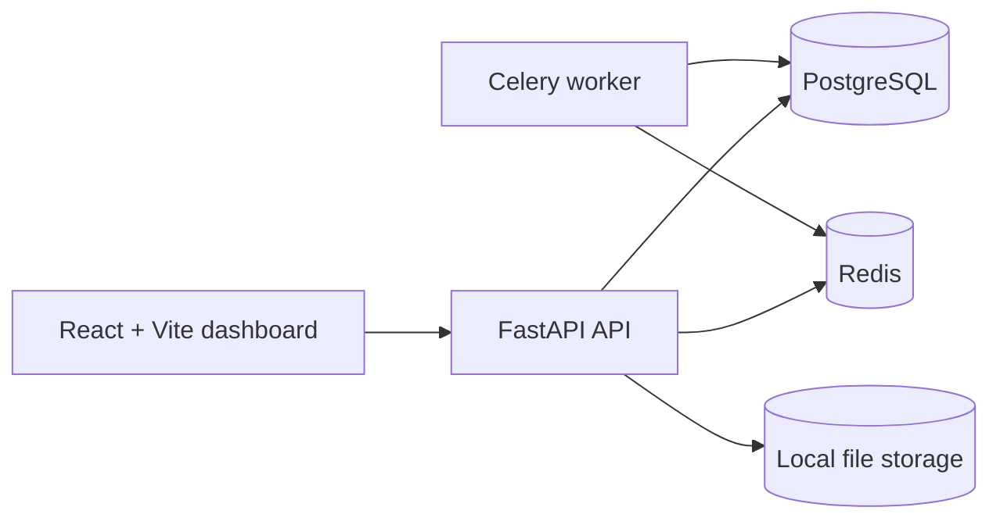

# DataMind

DataMind is an autonomous data quality and investigation platform. The project combines deterministic Python validation tools with a two-agent investigation loop and a polished dashboard.

## Phase 1 status

This repository currently includes the scaffold for:

- FastAPI backend with health endpoint and dataset upload/versioning
- React + Vite frontend shell
- PostgreSQL + pgvector + Redis + Celery service stack
- Alembic migration setup
- Demo dataset generator
- Initial pytest coverage

## Local setup and secrets

Create a local `.env` from `.env.example` and set the values before running the stack. Do not commit `.env` files. The compose stack requires `POSTGRES_PASSWORD` to be present in `.env`.

```bash
cp .env.example .env
python -m venv .venv
source .venv/bin/activate  # or .venv\Scripts\activate on Windows
pip install -r backend/requirements.txt -r backend/requirements-dev.txt
pip install pre-commit
pre-commit install
pytest
uvicorn app.main:app --reload --app-dir backend
```

For the full Docker stack:

```bash
cp .env.example .env
# Set POSTGRES_PASSWORD in .env before starting the services.
docker compose up -d postgres redis
docker compose up -d --build api worker
```

## Running the stack

```bash
cp .env.example .env
# Set POSTGRES_PASSWORD in .env before starting the services.
docker compose up -d postgres redis
docker compose up -d --build api worker
```

Health check: http://127.0.0.1:8000/health

## Architecture



## Notes

This is the foundation for the later phases described in the project brief, including the deterministic tool layer, workflow controller, and agent-driven investigation flow. Local services are bound to `127.0.0.1` and credentials are supplied via `.env` instead of being committed to git.
