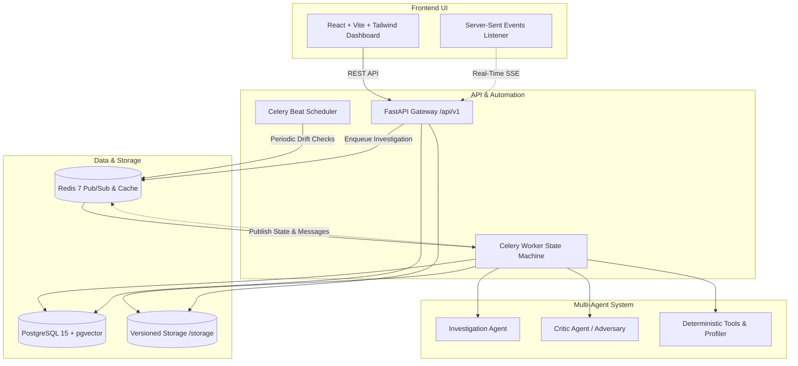

# DataMind

DataMind is an autonomous data quality, repair, and investigation platform. It pairs deterministic statistical detection tools with an adversarial investigator-critic agent debate and an interactive real-time dashboard. Every repair decision is verified against strict Kolmogorov-Smirnov and Population Stability Index (PSI) distribution tolerances, maintaining immutable ancestry and cryptographic hashes across every dataset version.

## Architecture



---

## Setup & Quickstart

### 1. Configure Environment
Copy `.env.example` to `.env` and generate a secure password for PostgreSQL:

```bash
cp .env.example .env
# Set a secure POSTGRES_PASSWORD in .env
```

### 2. Start Services
Using Makefile:
```bash
make up
```
Or directly with Docker Compose:
```bash
docker compose up -d
```
All services bind to `127.0.0.1`:
- **Frontend Dashboard**: [http://127.0.0.1:5173](http://127.0.0.1:5173)
- **FastAPI Documentation**: [http://127.0.0.1:8000/docs](http://127.0.0.1:8000/docs)
- **Health Check**: [http://127.0.0.1:8000/api/v1/health](http://127.0.0.1:8000/api/v1/health)

### 3. Pre-commit Hooks (Security & Secrets)
Pre-commit is configured with **gitleaks** and **detect-secrets** to prevent credentials from ever being staged or committed:
```bash
pip install pre-commit
pre-commit install
```

---

## 60-Second Demo Walkthrough

1. **Launch the Demo Dataset**:
   Navigate to [http://127.0.0.1:5173](http://127.0.0.1:5173) and click **"Try the demo"**. This generates a deterministic customer & transaction dataset with 8 planted data quality anomalies (mixed date formats, exact & near duplicates, currency symbols/thousands commas, numbers stored as text, MAR dependent missingness, known extreme outliers, and state label variants).
2. **Start the Autonomous Investigation**:
   On the dataset versions page, click **"Investigate"**. The system enqueues a Celery task that drives the deterministic state machine.
3. **Watch the Workflow Graph**:
   On `/investigations/:id`, watch the state machine illuminate through `PROFILE` &rarr; `INVESTIGATE` &rarr; `CRITIQUE` &rarr; `ROUTE` &rarr; `EXECUTE` &rarr; `REPROFILE` &rarr; `VERIFY` &rarr; `REPORT` &rarr; `COMPLETED`, powered by Server-Sent Events (SSE).
4. **Inspect the Debate & Health Score**:
   - In the **Debate Panel**, view the side-by-side proposals and critic verdicts with `APPROVE`, `REJECT`, and `ESCALATE` badges.
   - In the **Health Score** tab, watch the 5-dimension deterministic quality score animate from before (~65%) to after (~98%) across Completeness, Uniqueness, Consistency, Validity, and Accuracy.
   - Inspect the **Diff Viewer** to see cell-level diffs, removed duplicate rows (struck through in red), and the **Distributions** tab showing 20-bin histograms with Kolmogorov-Smirnov p-values.
5. **Review Escalations (Human-in-the-Loop)**:
   Navigate to `/reviews` to inspect pending escalations. Use keyboard shortcuts (`A` to approve, `E` to edit JSON parameters inline, `R` to reject, arrow keys to navigate).
6. **Download the Cleaned Dataset & Reports**:
   Download the cleaned dataset (retaining XLSX/CSV source type format and immutable parent lineage), and export reports in **JSON**, **Markdown**, **HTML**, or **PDF**.

---

## Design Decisions

- **Two-Agent Architecture (Investigator & Critic)**: Rather than relying on a single prompt to both diagnose and clean data, DataMind uses an adversarial loop. The Investigator generates targeted proposals; the Critic receives raw tool detector outputs (not summaries) to reject flawed fixes or escalate ambiguous anomalies to human review.
- **Deterministic Tool Layer**: All data operations (deduplication, date parsing, symbol stripping, IQR/IsolationForest outlier detection, KS-tests, PSI drift calculation) are written in pure, deterministic Python/pandas. The LLM suggests operations and parameters; code executes deterministically.
- **pgvector vs. External Vector Database**: At this dataset scale, running `pgvector` inside the primary PostgreSQL database eliminates synchronization overhead, distributed transaction failures, and extra infrastructure dependencies while enabling fast HNSW cosine-distance similarity indexing.
- **Custom State Machine vs. LangGraph**: The workflow state machine is implemented as a pure, dependency-injected controller with database checkpoints before every state transition. This guarantees idempotency, resumability after worker crashes, and full testability without external orchestration lock-in.
- **Google Agent Development Kit (ADK)**: Used for structuring agent interactions, function calling schemas, and provider abstractions across Gemini and mock runners.

---

## Switching to Gemini

By default, DataMind runs with `LLM_PROVIDER=mock`, which executes deterministic reject-then-approve and escalation paths without external network dependencies.

To switch to Google Gemini:
1. Obtain an API key from Google AI Studio.
2. Update your `.env` configuration:
   ```env
   LLM_PROVIDER=gemini
   GEMINI_MODEL=gemini-2.5-flash
   GOOGLE_API_KEY=your_actual_api_key_here
   ```
3. Restart services:
   ```bash
   make up
   ```
*Note: If `LLM_PROVIDER=gemini` is configured without a valid `GOOGLE_API_KEY`, startup fails fast with a clear diagnostic message.*

---

## Known Limitations

- **Connector Breadth**: The `FileSource` connector is fully implemented for `.csv`, `.xlsx`, and `.xls`. Database sources (such as `PostgresSource`) are architected as roadmap seams and currently raise `NotImplementedError`.
- **Large Dataset Memory Bound**: Datasets are processed in-memory using pandas DataFrames. Single tables exceeding host RAM should be partitioned prior to ingestion.
- **Browser Automation Verification**: Interactive browser verification requires Playwright or headless Chrome in environments where no GUI desktop is available.
